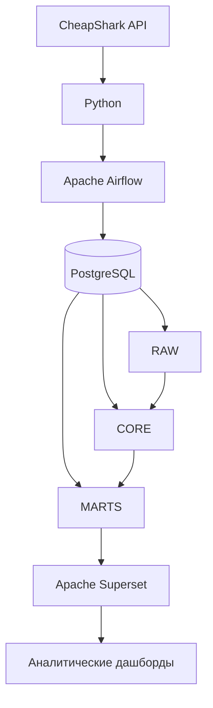

# 🎮 Game Deal Intelligence

**Game Deal Intelligence** — проект по сбору, обработке и анализу данных о ценах на видеоигры и игровых предложениях.

Проект получает данные из CheapShark API, сохраняет исходные ответы, обрабатывает информацию об играх, магазинах и ценах, отслеживает изменения стоимости предложений и подготавливает данные для аналитики в Apache Superset.

Основная цель проекта — построить автоматизированный ETL-процесс, который позволяет не только анализировать актуальные игровые предложения, но и отслеживать историю изменения цен.

---

## 📌 Содержание

1. [О проекте](#-о-проекте)
2. [Основные возможности](#-основные-возможности)
3. [Архитектура проекта](#-архитектура-проекта)
4. [Технологический стек](#-технологический-стек)
5. [Модель данных](#-модель-данных)
6. [ETL-пайплайны](#-etl-пайплайны)
7. [История изменения цен](#-история-изменения-цен)
8. [Структура репозитория](#-структура-репозитория)
9. [Запуск проекта](#-запуск-проекта)
10. [Мониторинг и обработка ошибок](#-мониторинг-и-обработка-ошибок)
11. [Ограничения текущей реализации](#-ограничения-текущей-реализации)
12. [Планы развития](#-планы-развития)
13. [Документация](#-документация)

---

## 🎯 О проекте

При покупке видеоигр пользователи часто сравнивают цены в разных магазинах, ищут скидки и пытаются определить, действительно ли текущее предложение выгодно.

Game Deal Intelligence решает эту задачу с точки зрения Data Engineering.

Вместо ручного сбора информации проект автоматически получает данные из внешнего API, сохраняет их в PostgreSQL и формирует структурированную модель для последующего анализа.

Особое внимание уделено истории цен: система сохраняет предыдущие состояния предложений при обнаружении изменений, что позволяет анализировать динамику стоимости игр.

**Основной источник данных:** [CheapShark API](https://apidocs.cheapshark.com/).

## 🚀 Основные возможности

- Получение информации об игровых магазинах и предложениях через REST API.
- Первоначальная загрузка данных (Initial Load).
- Регулярная инкрементальная синхронизация (Incremental Sync).
- Сохранение исходных ответов API в формате JSONB.
- Разделение данных на RAW, CORE и MARTS.
- Хранение актуальных предложений по играм и магазинам.
- Архивирование предыдущих состояний цен.
- Отслеживание запусков ETL-процессов.
- Обработка ограничений API и частичной загрузки.
- Подготовка аналитических данных для Apache Superset.

## 🏗 Архитектура проекта

Проект построен на основе многослойной архитектуры хранения данных.

### Общая схема



### Слои хранения данных

| Слой | Назначение |
|---|---|
| RAW | Хранение исходных ответов API и информации о запусках пайплайнов |
| CORE | Структурированные данные об играх, магазинах и предложениях |
| MARTS | Аналитические представления и наборы данных для визуализации |

**RAW**

Слой RAW сохраняет исходные ответы API в JSONB и информацию о выполнении пайплайнов.

Это позволяет сохранять первоначальные данные источника и отслеживать историю загрузок.

**CORE**

Слой CORE содержит основные сущности проекта:

- Игры.
- Магазины.
- Актуальные предложения.
- Исторические состояния цен.

**MARTS**

Слой MARTS предназначен для подготовки аналитических представлений на основе CORE.

Он используется как источник данных для Apache Superset.

## 🛠 Технологический стек

| Технология | Назначение |
|---|---|
| Python | Извлечение данных и логика обработки |
| Apache Airflow | Оркестрация и планирование ETL-процессов |
| PostgreSQL | Хранение данных |
| SQL | Трансформация и загрузка данных |
| Docker | Контейнеризация окружения |
| CheapShark API | Внешний источник данных |
| Apache Superset | Аналитика и визуализация |

## 🗄 Модель данных

Для организации данных используются три схемы PostgreSQL: `raw`, `core` и `marts`.

### RAW

| Таблица | Назначение |
|---|---|
| `raw.pipeline_runs` | Информация о запусках пайплайнов |
| `raw.raw_api_responses` | Исходные ответы API |

### CORE

| Таблица | Назначение |
|---|---|
| `core.games` | Справочник игр |
| `core.stores` | Справочник магазинов и контрольные точки синхронизации |
| `core.deals_current` | Актуальные предложения |
| `core.deals_price_history` | История предыдущих состояний предложений |

### MARTS

Схема предназначена для аналитических представлений и наборов данных, используемых в Superset.

### Основные связи

- Одна игра может иметь предложения в нескольких магазинах.
- Один магазин может содержать предложения для множества игр.
- Для каждой пары «игра — магазин» хранится одно актуальное предложение.
- Для одной игры и одного магазина может существовать множество исторических записей.
- Исторические записи связаны с запусками пайплайнов через `run_id`.

Подробное описание таблиц, полей, ограничений и связей приведено в [документации модели данных](docs/data_model.md).

## ⚙️ ETL-пайплайны

В проекте реализованы два основных подхода к загрузке данных.

### 1. Initial Load

Предназначен для первоначального наполнения базы данных.

Основные этапы:

1. Создание записи о запуске в `raw.pipeline_runs`.
2. Получение информации об игровых магазинах.
3. Получение доступных предложений.
4. Сохранение исходных ответов API в RAW.
5. Загрузка информации об играх.
6. Загрузка информации о магазинах.
7. Загрузка актуальных предложений.
8. Завершение запуска и фиксация его статуса.

### 2. Incremental Sync

Предназначен для регулярного обновления данных без повторной полной загрузки всех предложений.

Основные этапы:

1. Регистрация нового запуска.
2. Получение информации об изменениях магазинов.
3. Сохранение исходного ответа API.
4. Сравнение временных отметок с контрольными точками в `core.stores`.
5. Определение магазинов, требующих синхронизации.
6. Получение предложений с использованием пагинации.
7. Сохранение ответов API в RAW.
8. Обновление информации об играх.
9. Архивирование предыдущих состояний предложений при изменении цен.
10. Обновление актуальных предложений.
11. Обновление контрольных точек синхронизации.
12. Завершение запуска.

### Контрольные точки синхронизации

Для определения необходимости обновления используется поле `last_change_unix` таблицы `core.stores`.

Оно хранит временную отметку последнего изменения данных магазина, полученную из API.

При очередном запуске пайплайн сравнивает её с актуальным значением из источника.

Если магазин требует обновления, его предложения загружаются повторно.

Контрольная точка продвигается только после успешной обработки данных магазина.

## 📉 История изменения цен

Одна из ключевых особенностей проекта — разделение актуальных предложений и истории цен.

Для этого используются две таблицы:

- `core.deals_current` — последнее известное состояние предложения.
- `core.deals_price_history` — предыдущие состояния предложения.

Перед обновлением актуальных предложений выполняется архивирование предыдущего состояния, если обнаружено изменение цены.

Историческая запись содержит:

- Игру и магазин.
- Идентификатор предложения.
- Предыдущую цену.
- Обычную цену.
- Размер скидки.
- Признак наличия скидки.
- Время изменения по данным источника.
- Время наблюдения предыдущего состояния.
- Время архивирования.
- Идентификатор запуска пайплайна.

Такая модель позволяет анализировать изменения цен во времени и сравнивать текущие предложения с ранее зафиксированными значениями.

## 📂 Структура репозитория

Основные каталоги проекта:

```text
game-deal-intelligence/
│
├── dags/
│   ├── game_deals_initial_load.py
│   ├── game_deals_incremental_sync.py
│   │
│   ├── game_deals/
│   │   ├── common.py
│   │   ├── constants.py
│   └── └── sheapshark.py
│   
├── sql/
│   ├── archive_price_changes.sql
│   ├── load_deals_incremental.sql
│   ├── load_deals_to_core.sql
│   ├── load_games_incremental.sql
│   ├── load_games_to_core.sql
│   ├── load_stores_to_core.sql
│   ├── update_store_checkpoints.sql
│   │
│   ├── ddl/
│   ├── └── DDL.sql
│   │
│   ├── marts/
│   │   ├── mart_current_deals.sql
│   └── └── mart_game_price_history.sql
│
├── docs/
│   ├── architecture.md
│   ├── data_model.md
│   ├── pipeline_design.md
│   ├── api_integration.md
│   └── screenshots/
│
├── compose.yaml
├── README.md
├── .env
├── .env.example
└── .gitignore
```

## ▶️ Запуск проекта

### Предварительные требования

Для запуска проекта необходимы:

- Docker.
- Docker Compose.
- Git.

### 1. Клонирование репозитория

```bash
git clone https://github.com/nadenka-b/game-deal-intelligence.git
cd game-deal-intelligence
```

### 2. Структура окружения

Проект использует Docker Compose для запуска следующих сервисов:

- PostgreSQL 16.
- Apache Airflow 2.11.2.
- Apache Superset 3.0.1.

Все сервисы подключены к общей Docker-сети `game_network`.

### 3. Запуск контейнеров

Для первоначальной инициализации Airflow используется отдельный сервис `airflow-init`.

Сначала выполните:

```bash
docker compose up airflow-init
```

После успешной инициализации запустите остальные сервисы:

```bash
docker compose up -d
```

Проверить состояние контейнеров можно командой:

```bash
docker compose ps
```

### 4. Доступ к веб-интерфейсам

После запуска сервисов интерфейсы доступны по следующим адресам:

| Сервис | URL |
|---|---|
| Apache Airflow | http://localhost:8080 |
| Apache Superset | http://localhost:8088 |

Учетные данные, заданные в текущей конфигурации:

**Apache Airflow**

- Username: `admin`
- Password: `admin_password`

**Apache Superset**

- Username: `admin`
- Password: `admin_password`

### 5. Подключение к PostgreSQL

PostgreSQL доступен на порту `5432`.

Параметры подключения, заданные в текущей конфигурации:

| Параметр | Значение |
|---|---|
| Host | `localhost` |
| Port | `5432` |
| Database | `game_dwh` |
| Username | `postgres` |
| Password | `postgres` |

Для подключений между контейнерами в качестве хоста PostgreSQL используется имя сервиса `postgres`.

### 6. Инициализация базы данных

После запуска PostgreSQL необходимо создать структуру базы данных.

Для этого выполните DDL-скрипт `DDL.sql`, который создаёт схемы и таблицы проекта:

- `raw`
- `core`
- `marts`

### 7. Настройка подключений Airflow

В интерфейсе Airflow необходимо настроить следующие Connections:

| Connection ID | Назначение |
|---|---|
| `game_deals_postgres` | Подключение к PostgreSQL |
| `api_cheapshark` | Подключение к CheapShark API |

### 8. Запуск ETL-пайплайнов

После настройки базы данных и подключений можно запускать DAG:

- **Initial Load** — первоначальная загрузка данных.
- **Incremental Sync** — регулярное обновление данных.

Статус выполнения пайплайнов и историю запусков можно отслеживать в интерфейсе Apache Airflow.

### 9. Остановка проекта

Для остановки контейнеров:

```bash
docker compose down
```

Для остановки контейнеров с удалением томов данных:

```bash
docker compose down -v
```

**Внимание:** команда `docker compose down -v` удаляет данные PostgreSQL и Superset, сохранённые в Docker volumes. Используйте её только при необходимости полного сброса окружения.

## 📊 Мониторинг и обработка ошибок

Для отслеживания выполнения пайплайнов используется таблица `raw.pipeline_runs`.

Предусмотрены следующие статусы:

| Статус | Описание |
|---|---|
| `running` | Пайплайн выполняется |
| `success` | Пайплайн завершился успешно |
| `failed` | Пайплайн завершился с ошибкой |
| `partial` | Выполнена только часть загрузки |

При частичной загрузке уже полученные данные сохраняются в RAW, а контрольные точки незавершённых магазинов не продвигаются.

Это позволяет повторить синхронизацию без потери возможности получить пропущенные данные.

## 🔮 Планы развития

Возможные направления дальнейшего развития проекта:

- Интеграция RAWG API для обогащения информации об играх.
- Расширение аналитических представлений в MARTS.
- Развитие Superset-дашбордов.
- Добавление дополнительных проверок качества данных.
- Улучшение мониторинга и уведомлений о сбоях.
- Расширение аналитики исторических цен.

## 📚 Документация

Подробное описание отдельных компонентов проекта находится в каталоге `docs/`.

| Документ | Описание |
|---|---|
| [Architecture](docs/architecture.md) | Общая архитектура проекта |
| [Data Model](docs/data_model.md) | Структура базы данных и связи между таблицами |
| [Pipeline Design](docs/pipeline_design.md) | Логика ETL-пайплайнов |
| [API Integration](docs/api_integration.md) | Взаимодействие с CheapShark API |

## 👨‍💻 О проекте

Game Deal Intelligence — практический проект, направленный на применение инструментов и подходов Data Engineering:

- Построение ETL-пайплайнов.
- Оркестрация процессов с помощью Apache Airflow.
- Работа с REST API.
- Проектирование реляционной модели данных.
- Работа с PostgreSQL и SQL.
- Реализация инкрементальной загрузки.
- Хранение истории изменений.
- Подготовка данных для аналитики.

