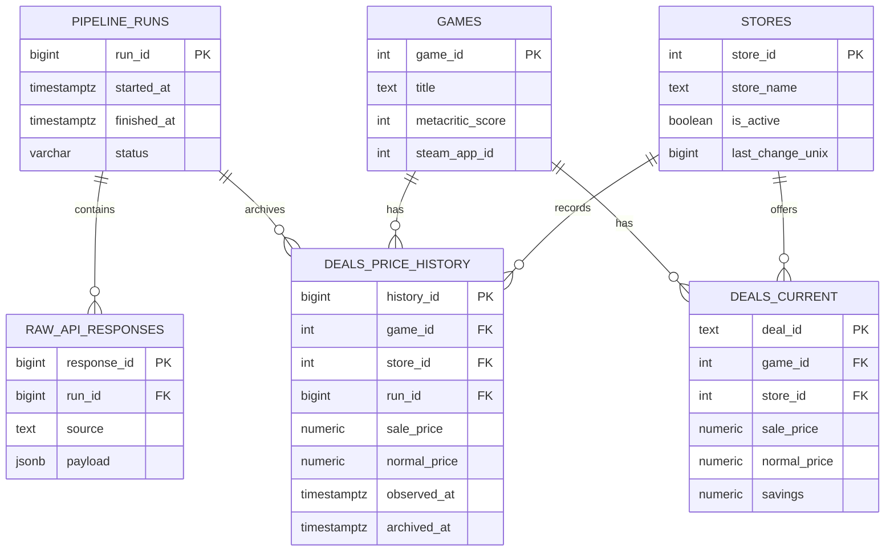

# Модель данных (Data Model)

## 1. Общая структура

В проекте используется PostgreSQL с разделением данных на три схемы:

| Схема | Назначение |
|---|---|
| `raw` | Хранение исходных ответов API и информации о запусках пайплайнов |
| `core` | Хранение структурированных данных об играх, магазинах и ценах |
| `marts` | Подготовка данных для аналитики и визуализации |

Основная бизнес-модель построена вокруг игр, магазинов и предложений (deals).

Для каждой пары «игра — магазин» хранится одно актуальное предложение. Предыдущие состояния предложений сохраняются отдельно в таблице истории цен.

## 2. Схема RAW

Схема `raw` отвечает за сохранение исходных данных и отслеживание выполнения пайплайнов.

### 2.1. `raw.pipeline_runs`

Таблица содержит информацию о каждом запуске пайплайна.

| Поле | Тип | Описание |
|---|---|---|
| `run_id` | BIGINT | Уникальный идентификатор запуска, Primary Key |
| `started_at` | TIMESTAMPTZ | Время начала запуска |
| `finished_at` | TIMESTAMPTZ | Время завершения запуска |
| `status` | VARCHAR(10) | Статус выполнения |
| `error_message` | TEXT | Информация об ошибке, если она возникла |

Возможные статусы, предусмотренные логикой проекта: `running`, `success`, `failed`, `partial`.

### 2.2. `raw.raw_api_responses`

Таблица предназначена для хранения исходных ответов API в формате JSONB.

| Поле | Тип | Описание |
|---|---|---|
| `response_id` | BIGINT | Уникальный идентификатор ответа, Primary Key |
| `run_id` | BIGINT | Идентификатор запуска пайплайна, Foreign Key |
| `source` | TEXT | Источник данных |
| `loaded_at` | TIMESTAMPTZ | Время сохранения ответа |
| `page_number` | INT | Номер страницы ответа |
| `page_size` | INT | Размер страницы |
| `count_result` | INT | Количество результатов |
| `payload` | JSONB | Исходный ответ API |

Связь с `raw.pipeline_runs` позволяет определить, в рамках какого запуска были получены исходные данные.

## 3. Схема CORE

Схема `core` содержит основные структурированные данные проекта.

### 3.1. `core.games`

Справочник видеоигр.

| Поле | Тип | Описание |
|---|---|---|
| `game_id` | INT | Идентификатор игры, Primary Key |
| `title` | TEXT | Название игры |
| `internal_name` | TEXT | Внутреннее название игры |
| `metacritic_score` | INT | Оценка Metacritic |
| `steam_rating_text` | TEXT | Текстовая оценка Steam |
| `steam_rating_percent` | INT | Процент положительных отзывов |
| `steam_rating_count` | INT | Количество отзывов Steam |
| `steam_app_id` | INT | Идентификатор приложения Steam |
| `release_date` | TIMESTAMPTZ | Дата выхода игры |
| `thumb` | TEXT | Ссылка на изображение игры |

Ограничения целостности:

- `game_id` является первичным ключом.
- `title` не может быть NULL.
- `metacritic_score` и `steam_rating_percent` ограничены диапазоном от 0 до 100.
- `steam_rating_count` не может быть отрицательным.

### 3.2. `core.stores`

Справочник игровых магазинов.

| Поле | Тип | Описание |
|---|---|---|
| `store_id` | INT | Идентификатор магазина, Primary Key |
| `store_name` | TEXT | Название магазина |
| `is_active` | BOOLEAN | Признак активности магазина |
| `observed_at` | TIMESTAMPTZ | Время наблюдения за магазином |
| `last_change_unix` | BIGINT | Временная отметка последнего изменения данных магазина в формате Unix |

Поле `last_change_unix` используется для хранения контрольной точки синхронизации данных магазина.

### 3.3. `core.deals_current`

Таблица содержит актуальные предложения по играм в магазинах.

| Поле | Тип | Описание |
|---|---|---|
| `deal_id` | TEXT | Идентификатор предложения, Primary Key |
| `game_id` | INT | Идентификатор игры, Foreign Key |
| `store_id` | INT | Идентификатор магазина, Foreign Key |
| `sale_price` | NUMERIC(10,2) | Текущая цена со скидкой |
| `normal_price` | NUMERIC(10,2) | Обычная цена |
| `savings` | NUMERIC(5,2) | Размер скидки в процентах |
| `is_on_sale` | BOOLEAN | Признак наличия скидки |
| `source_last_change` | TIMESTAMPTZ | Время последнего изменения по данным источника |
| `discount_calculable` | BOOLEAN | Признак возможности расчёта скидки |
| `deal_rating` | NUMERIC(3,1) | Рейтинг предложения |

Особенности таблицы:

- `deal_id` является первичным ключом.
- `game_id` ссылается на `core.games`.
- `store_id` ссылается на `core.stores`.
- Пара `game_id` + `store_id` должна быть уникальной.
- Цены не могут быть отрицательными.
- Значение `savings` должно находиться в диапазоне от 0 до 100, если оно не равно NULL.

Таким образом, таблица хранит только одно актуальное предложение для каждой пары «игра — магазин».

### 3.4. `core.deals_price_history`

Таблица предназначена для хранения предыдущих состояний предложений при изменении цен.

| Поле | Тип | Описание |
|---|---|---|
| `history_id` | BIGINT | Уникальный идентификатор исторической записи, Primary Key |
| `game_id` | INT | Идентификатор игры, Foreign Key |
| `store_id` | INT | Идентификатор магазина, Foreign Key |
| `deal_id` | TEXT | Идентификатор предложения |
| `sale_price` | NUMERIC(10,2) | Цена со скидкой |
| `normal_price` | NUMERIC(10,2) | Обычная цена |
| `savings` | NUMERIC(5,2) | Размер скидки в процентах |
| `is_on_sale` | BOOLEAN | Признак наличия скидки |
| `source_last_change` | TIMESTAMPTZ | Время последнего изменения по данным источника |
| `observed_at` | TIMESTAMPTZ | Время, когда состояние предложения было зафиксировано |
| `archived_at` | TIMESTAMPTZ | Время сохранения записи в архив |
| `run_id` | BIGINT | Идентификатор запуска пайплайна, Foreign Key |

Особенности таблицы:

- `history_id` является первичным ключом.
- `game_id` ссылается на `core.games`.
- `store_id` ссылается на `core.stores`.
- `run_id` ссылается на `raw.pipeline_runs`.
- Цены не могут быть отрицательными.
- Значение `savings` должно находиться в диапазоне от 0 до 100, если оно не равно NULL.

Таблица позволяет сохранять историю наблюдаемых состояний цен и связывать каждое архивирование с конкретным запуском пайплайна.

## 4. Схема MARTS

Схема `marts` предназначена для аналитических представлений, построенных на основе данных CORE.

Она используется как слой доступа к данным для Apache Superset.

[Создание представлений](../sql/marts/)

## 5. Связи между таблицами

Основные связи модели данных:

- `raw.pipeline_runs` → `raw.raw_api_responses`: один запуск может содержать несколько сохранённых ответов API.
- `core.games` → `core.deals_current`: одна игра может иметь предложения в нескольких магазинах.
- `core.stores` → `core.deals_current`: один магазин может содержать предложения для множества игр.
- `core.games` → `core.deals_price_history`: для одной игры может храниться множество исторических записей.
- `core.stores` → `core.deals_price_history`: для одного магазина может храниться множество исторических записей.
- `raw.pipeline_runs` → `core.deals_price_history`: один запуск пайплайна может архивировать множество состояний предложений.

## 6. ER-диаграмма

## 7. Особенности модели данных

Основные принципы проектирования:

1. Разделение исходных и структурированных данных. Исходные ответы API сохраняются отдельно от обработанных сущностей.

2. Разделение текущих и исторических данных. Актуальные предложения хранятся в deals_current, предыдущие состояния — в deals_price_history.

3. Контроль целостности. Первичные и внешние ключи, уникальные ограничения и CHECK-ограничения защищают данные от ряда некорректных значений.

4. Отслеживание загрузок. Записи истории цен связаны с конкретными запусками пайплайнов.

5. Подготовка к аналитике. Слой MARTS предназначен для предоставления данных в удобном для визуализации виде.